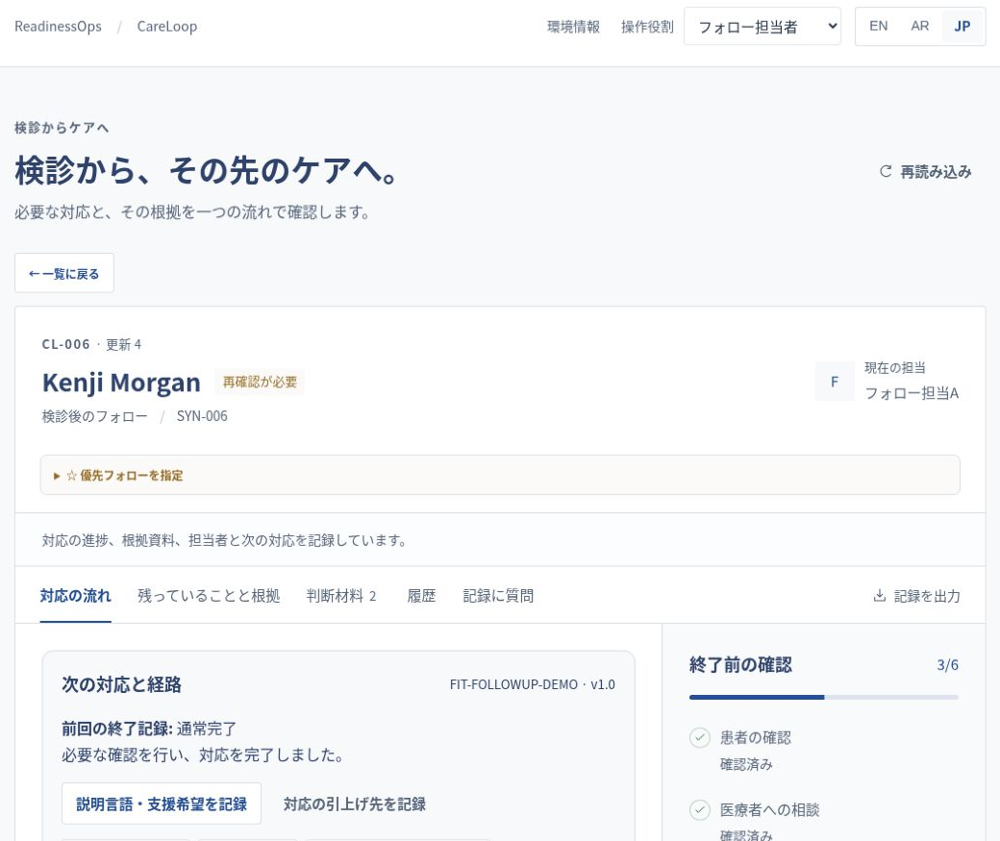

# CareLoop

**健診で見つかった要対応事項を、必要な検査とケアにつなげる。**

CareLoopは、原資料、現在の担当者、次の対応を結び付けます。報告書が訂正されたときは、以前の判断を残しながら、どの確認をやり直す必要があるかを示します。担当者はGeminiを使って自然言語で質問し、回答の根拠となる記録をたどれます。

[English](README.md) · [デモ動画](https://youtu.be/y_zqr-R8R3g) · [Live demoを開く](https://careloop-demo-864232222461.asia-northeast1.run.app/entry/) · [試用ガイド](docs/demo-guide.ja.md) · [構成図](docs/architecture.ja.md) · [実装と検証](docs/reviewer-map.ja.md)

合成データで動く試作です。[デモ動画](https://youtu.be/y_zqr-R8R3g)では、**v0.5.2（RC9）**の **CL-006 / Kenji Morgan / SYN-006** を扱います。

## 解消を目指す課題

紹介先を受診していても、必要な検査まで実施されたとは限りません。「受診完了」という表示だけでは、健診で見つかった問題から必要なケアに至る途中の未完了事項が見えなくなることがあります。

CareLoopは、完了判断を支える資料を確認できるようにします。資料が訂正された場合は、現在の確認を失効させつつ、過去に人が行った判断を保持します。今回の試作では、便潜血検査（FIT）陽性後のフォローを示しています。

## 実演と同じ症例を確認する

1. [日本語のアプリ](https://careloop-demo-864232222461.asia-northeast1.run.app/?lang=ja)を開き、操作役割を **フォロー担当者** にします。[英語](https://careloop-demo-864232222461.asia-northeast1.run.app/?lang=en)とアラビア語も言語選択から利用できます。
2. 最初の4件のみが表示される場合は、**300名規模で確認** を一度押します。元の記録を残して、実演用の記録が追加されます。
3. **CL-006** を検索し、**Kenji Morgan** を開きます。**履歴**、**判断材料**、**残っていることと根拠** を確認します。
4. **記録に質問** で **「なぜ再確認が必要になりましたか？」** と質問します。回答の根拠を確認し、現在の担当者と次の対応の登録状況をたどります。

[試用ガイド](docs/demo-guide.ja.md)には、確認できる状態と、別のCL-001を使うPDF取込み・終了操作の手順を記載しています。独立した試用には別のブラウザプロファイルかプライベートウィンドウを使用します。同じプロファイルのタブはセッションを共有します。日付や件数は、作業領域の作成時点や後の操作によって変わります。

*現在の実演に使用するCL-006。訂正後も有効な確認は6項目中3項目です。以前の終了判断は履歴に残っています。画像はクリックで拡大できます。*

## デモで確認できること

| 状況 | CareLoopの動作 |
| --- | --- |
| 終了後に「診察のみ・必要な検査は未実施」と訂正された | 再確認が必要な状態に戻る。検査実施の根拠、医師の結果確認、方針の説明を確認し直す必要があり、以前の資料と終了判断も保持する。 |
| 担当者が再確認の理由を質問する | Geminiが質問の意図を読み取り、関連する記録と原文を選ぶ。システムが記録の値・参照元・確認時点を結び付けて回答する。質問では症例の記録を変更しない。 |
| 必要な情報がない、または有効な資料が矛盾する | 不足・矛盾を明示する。担当者は回答に付いた参照元を確認できる。 |
| 次の対応が登録されていない | 現在の担当者と未登録であることを表示する。CL-006の開始状態ではフォロー担当Aが責任を持ち、次の対応は未登録。 |
| 他チームへ引継ぎを依頼する | 引継ぎ先が受け入れるまで、現在のチームに責任が残る。 |
| 患者が追加説明を希望する | 患者画面から理解したこと・説明の希望を記録する。案内を読んだことの記録とは区別する。 |

## 全体構成

原資料、抽出テキスト、AIによる支援、人の判断を区別して扱います。Geminiは自然言語での記録確認と、任意の資料レビュー候補の提示を支援します。APIが業務上の条件を管理し、人が終了を承認します。[構成と資料・判断の流れ](docs/architecture.ja.md)、[権限と運用](docs/security-and-operations.ja.md)、[実装・検証の対応表](docs/reviewer-map.ja.md)から詳細を確認できます。

## AIと人の役割

回答は、記録された事実の確認を支援します。担当者が参照元を確認し、必要な操作は症例の記録画面で行います。定義済みルールによる照合とGeminiのレビュー候補は区別して表示します。AIは終了を承認せず、診断・緊急度・治療も決定しません。

## 技術・検証資料

| 資料 | 内容 |
| --- | --- |
| [試用ガイド](docs/demo-guide.ja.md) | CL-006の訂正、根拠付き回答、担当の確認。CL-001のPDF演習も掲載。 |
| [構成図と資料・判断の流れ](docs/architecture.ja.md) | 構成要素、データ関係、AIの入出力と権限。 |
| [権限・データ管理・運用](docs/security-and-operations.ja.md) | 操作権限、保持、依存関係、容量、障害時の扱い。 |
| [実装・検証の対応表](docs/reviewer-map.ja.md) | 実演した機能と検証結果、今後の実証計画。 |
| [検証結果](docs/validation.ja.md) | 実施版・日付・範囲を明示した技術確認と、その限界。 |
| [実装範囲と制約](docs/scope-and-limitations.ja.md) | 試作の利用・評価範囲。 |
| [PDFの説明](demo-data/README.md) | 任意のCL-001演習に使う資料の識別情報とハッシュ。 |
| [権利・帰属情報](NOTICE.md) | 権利者と今回の公開範囲。 |

このリポジトリは、製品の説明資料、掲載画像、合成データのPDFを公開するものです。アプリの実装コードは含みません。検証は開発者による合成シナリオの技術確認であり、臨床効果、担当者の作業時間短縮、独立した実利用者評価は測定していません。

[SOLIFAN](https://www.solid-fdn.co.jp/)制作。Future Health Digital Innovation Challenge **課題05：Closing the Screening-to-Care Loop**向けの試作です。
