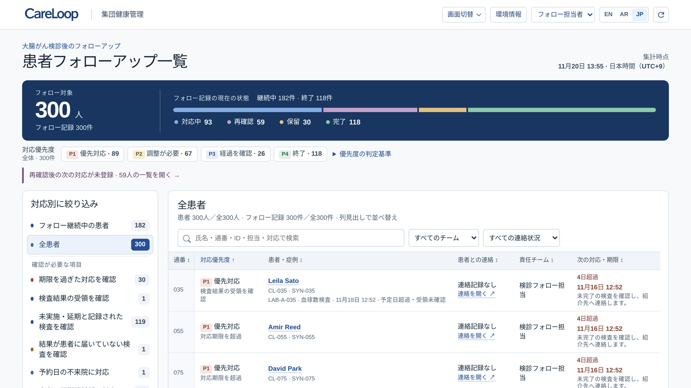

# CareLoop

**健診で見つかった要対応事項を、必要な検査とケアにつなげる。**

検査が終わっても、結果が患者さんに届いていないことがあります。予約日に来院できず、次の予約を誰に頼めばよいか分からない方もいます。CareLoopでは、どんな対応が残っているか、その根拠は何か、誰が担当するかを確認できます。

[日本語の操作デモ](https://careloop-demo-864232222461.asia-northeast1.run.app/?lang=ja) · [日本語動画（v6・2分58秒・MP4）](https://raw.githubusercontent.com/solidfdn/careloop/main/assets/careloop-demo-ja.mp4) · [応募用英語動画（v12・2分59秒・MP4）](https://raw.githubusercontent.com/solidfdn/careloop/main/assets/careloop-demo-en.mp4) · [英語技術資料（v3.3・PDF）](docs/CareLoop-Technical-Briefing-EN.pdf) · [English](README.md)

## 動画と同じ症例を開く

**v0.5.2 RC32** では、大腸がん検診後のフォローを想定してデモ環境用に作成した300人の一覧が開きます。初期状態でフォローが続いているのは182人です。一覧の左側で対応内容を選ぶと、該当する患者さんが表示されます。複数の対応が必要な方は、それぞれの一覧に表示されます。

| 確認する場面 | 画面でたどれる内容 |
| --- | --- |
| [検査結果が届いていない患者さん · CL-015](https://careloop-demo-864232222461.asia-northeast1.run.app/?lang=ja&queue=result_waiting) | 大腸内視鏡検査は実施済みですが、結果が患者さんに届いていません。資料を確認し、どのチームが紹介先に問い合わせ、いつ患者さんに連絡するかを登録します。 |
| [予約日に来院しなかった患者さん · CL-025](https://careloop-demo-864232222461.asia-northeast1.run.app/?lang=ja&queue=missed_appointment) | 次の予約が入っていないため、担当者が電話する予定を登録します。患者さんは「そちらから電話が来ますか」と尋ね、患者画面で担当者からの返信を読めます。 |
| [患者フォローアップ一覧](https://careloop-demo-864232222461.asia-northeast1.run.app/?lang=ja) | 「まだ説明を待っている患者さんは何人ですか？」と質問し、回答から該当する一覧を開きます。動画では、CL-025の患者さんが質問を送った時点で、対象300人のうち30人が再説明を待っています。 |

[操作ガイド](docs/demo-guide.ja.md)では、この順番で実際の画面を操作できます。紹介先が引継ぎを受ける例（CL-002）、報告書の訂正後に以前の判断を残して再確認する例（CL-006）、PDFを取り込む演習（CL-001）も掲載しています。[審査用デモの入口（英語）](https://careloop-demo-864232222461.asia-northeast1.run.app/entry/) ／ [アラビア語の操作画面](https://careloop-demo-864232222461.asia-northeast1.run.app/?lang=ar)

## フォローを終了するまで

CareLoopは、根拠となる資料、担当者の判断、担当チーム、次の対応を症例ごとに結び付けます。引継ぎ先が受け入れるまでは、依頼元のチームが担当します。患者さんは何を説明してほしいかを自分の言葉で記録でき、担当者はその質問を読んで返信できます。

Geminiは、記録についての質問への回答と、確認が必要な箇所を探す作業を支援します。担当者は根拠となる記述を開き、情報に不足や食い違いがある場合も資料に戻って確かめられます。終了に必要な条件をシステムが確認し、終了の承認は人が行います。

## 技術資料と検証

| 資料 | 内容 |
| --- | --- |
| [英語技術資料 v3.3（PDF・18ページ）](docs/CareLoop-Technical-Briefing-EN.pdf) | 動画で扱う2つの症例、システム構成図（10ページ）、検証結果、実証の範囲。 |
| [構成図と資料・判断の流れ](docs/architecture.ja.md) | 構成要素、記録の関係、AIが支援する範囲。 |
| [権限・データ管理・運用](docs/security-and-operations.ja.md) | 操作権限、データの保持、容量、障害時の扱い。 |
| [実装・検証の対応表](docs/reviewer-map.ja.md) | 実演する機能と検証結果、今後の実証計画。 |
| [検証結果](docs/validation.ja.md) ／ [実装範囲と制約](docs/scope-and-limitations.ja.md) | 検証した版、日付、対象と評価範囲。 |
| [PDF演習用ファイル](demo-data/README.md) ／ [権利・帰属情報](NOTICE.md) | CL-001の演習に使う資料、ファイルの照合方法、公開物の利用条件。 |

このリポジトリでは、デモ動画、製品と技術の説明資料、画面例、演習用PDFを公開しています。現段階では、デモ環境で一連の操作と記録を開発チームが検証しました。臨床上の効果や担当者の作業時間の変化は、今後の実証で評価する項目です。

[SOLIFAN](https://www.solid-fdn.co.jp/)制作。Future Health Digital Innovation Challenge **課題05「Closing the Screening-to-Care Loop」**向けの試作です。
