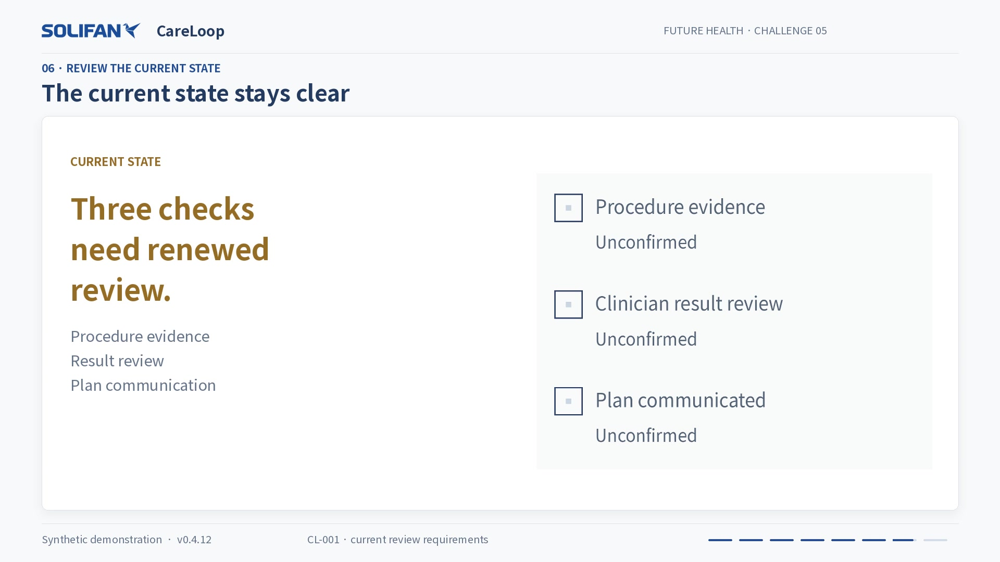

# CareLoop

**健診で見つかった要対応事項を、必要な検査とケアにつなげる。**

CareLoopは、健診後の担当者、次の対応、その判断の根拠、残っている確認事項を一つの流れで共有する仕組みです。資料が訂正された場合は再確認を促し、以前の資料と判断も辿れるようにします。

[English](README.md) · [日本語デモを開く](https://careloop-demo-864232222461.asia-northeast1.run.app/?lang=ja) · [試用ガイド](docs/demo-guide.ja.md) · [構成図](docs/architecture.ja.md) · [実装と検証](docs/reviewer-map.ja.md)

*架空症例で動く試作です。以下の図で仕組みを把握し、試用ガイドで実際の動作を確認できます。*

## 解消を目指す課題

紹介先を受診していても、必要な検査まで実施されたとは限りません。「受診完了」という表示だけでは、健診で見つかった問題から必要なケアに至る途中の未完了事項が見えなくなることがあります。

CareLoopは、原資料、担当チーム、次の対応、人による確認を同じ経路に結び付けます。今回の試作では、便潜血検査（FIT）陽性後のフォローを架空症例で示しています。

## 全体構成

原資料、担当チーム、人の判断を結び付けます。任意のAIは確認候補を提示し、APIが終了条件を管理します。[資料・判断の流れとデータ関係](docs/architecture.ja.md#pdfから判断まで)、[権限と運用](docs/security-and-operations.ja.md)、[実装・検証の対応表](docs/reviewer-map.ja.md)から詳細を確認できます。

## デモで確認できること

| 状況 | CareLoopの動作 |
| --- | --- |
| 受診済みでも、資料に検査未実施と記載されている | 原文を確認でき、必要な確認が不足する間は終了できない。 |
| 他チームへ引継ぎを依頼した | 引継ぎ先が受け入れるまで、現在のチームに責任が残る。 |
| 後日の報告書に完了が記載された | 新しい判断材料として追加する。人が根拠、以前の未完了事項の解消、対応の完了、結果確認、説明を記録する。 |
| その報告書が訂正された | 再確認が必要な状態に戻り、関連する確認が失効する。以前の資料と終了判断は保持される。 |

*承認済み動画の一場面。資料の訂正により、検査の実施根拠・結果確認・次の方針の説明が再確認対象になります。*

## 試用する

1. [日本語のアプリ](https://careloop-demo-864232222461.asia-northeast1.run.app/?lang=ja)を開きます。[英語](https://careloop-demo-864232222461.asia-northeast1.run.app/?lang=en)と、言語選択からアラビア語も利用できます。
2. **CL-001 / Alex Morgan / SYN-001**を選び、[日本語ガイド](docs/demo-guide.ja.md)に沿って操作します。
3. 同梱の[架空PDF](demo-data/README.md)で、後日の完了報告と、その訂正を確認します。

独立した試用には、別のブラウザプロファイルまたはプライベートウィンドウを使用します。同じプロファイルのタブはセッションを共有します。現在の画面はv0.4.12で、日本語の予定日時は日本時間、英語・アラビア語はアブダビ時間です。掲載画像は準備済みの例で、新規の試用領域は対応開始時点から始まります。

## AIと人の役割

ルール照合は、資料に残る関連記載を示します。任意のGemini支援は、原文に結び付いた確認候補を提案します。人が資料を確認して扱いと理由を記録します。AIは終了を承認せず、診断・緊急度・治療も決定しません。

## 技術・検証資料

| 資料 | 内容 |
| --- | --- |
| [試用ガイド](docs/demo-guide.ja.md) | 原資料の確認から、終了と訂正後の再確認まで。 |
| [構成図と資料・判断の流れ](docs/architecture.ja.md) | 2つの図、構成要素、データ関係、AIの入出力と権限。 |
| [権限・データ管理・運用](docs/security-and-operations.ja.md) | 操作権限、保持、依存関係、容量、障害時の扱い、費用前提。 |
| [実装・検証の対応表](docs/reviewer-map.ja.md) | 機能と根拠、審査の観点、今後の実証仮説。 |
| [検証結果](docs/validation.ja.md) | 対象バージョンを明示した技術確認と、その限界。 |
| [実装範囲と制約](docs/scope-and-limitations.ja.md) | 試作の利用・評価範囲。 |
| [PDFの説明](demo-data/README.md) | 資料の識別情報とハッシュ。 |
| [権利・帰属情報](NOTICE.md) | 権利者と今回の公開範囲。 |

このリポジトリは、製品の説明資料、掲載画像、架空PDFを公開するものです。アプリの実装コードは含みません。検証は開発者による架空シナリオの技術確認であり、臨床効果、担当者の作業時間短縮、独立した実利用者評価は測定していません。

[SOLIFAN](https://www.solid-fdn.co.jp/)制作。Future Health Digital Innovation Challenge **課題05：Closing the Screening-to-Care Loop**向けの試作です。
