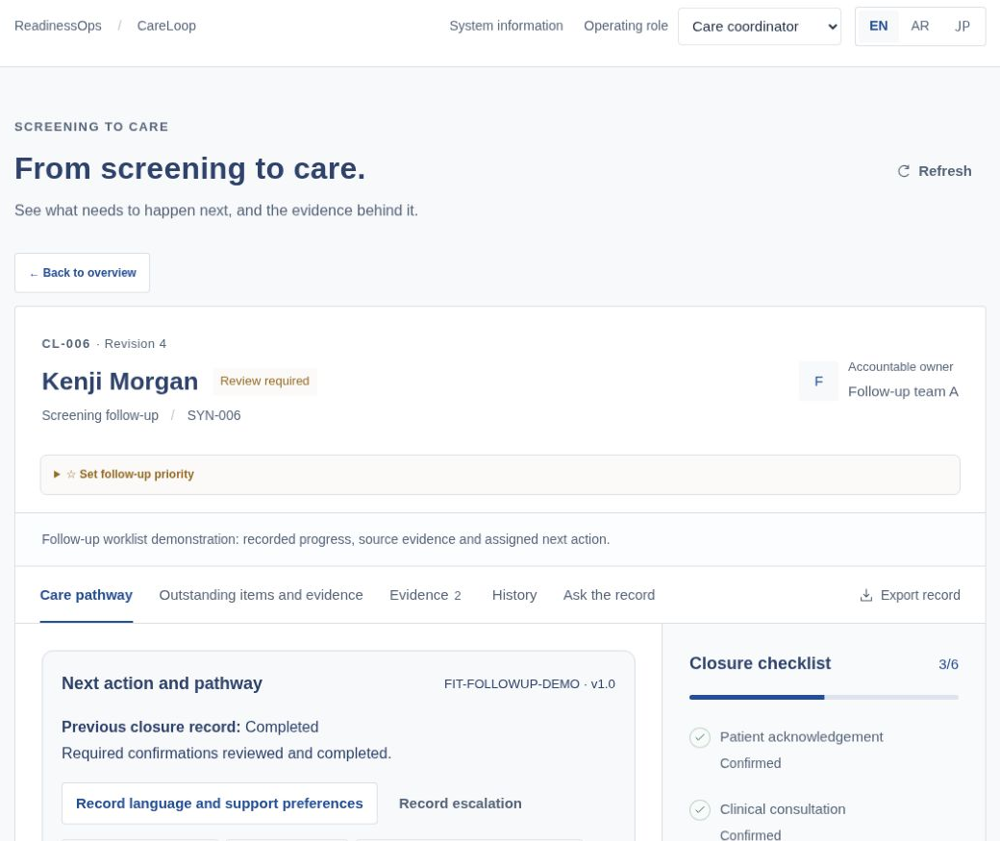

# CareLoop

**Helping screening results lead to the necessary tests and care.**

CareLoop connects source evidence, the accountable team and the next action. When a report is corrected, it identifies which confirmations need renewed review while retaining the earlier decision. Care teams can ask Gemini-supported questions in natural language and follow the answer back to the records.

[日本語](README.ja.md) · [Demo video](https://youtu.be/y_zqr-R8R3g) · [Open the live demo](https://careloop-demo-864232222461.asia-northeast1.run.app/entry/) · [Hands-on guide](docs/demo-guide.md) · [Architecture](docs/architecture.md) · [Review map](docs/reviewer-map.md)

A working prototype using synthetic records. The [demo video](https://youtu.be/y_zqr-R8R3g) follows **CL-006 / Kenji Morgan / SYN-006** in **v0.5.2 (RC9)**.

## The gap CareLoop addresses

A completed specialist visit can still leave the intended procedure unfinished. A status field alone can hide the gap between an abnormal screening result and the tests or care that need to follow.

CareLoop keeps the evidence behind completion visible. A correction can invalidate current confirmations without erasing the earlier human decision. The prototype demonstrates follow-up after a positive faecal immunochemical test (FIT).

## Try the demonstrated case

1. Open the [English workspace](https://careloop-demo-864232222461.asia-northeast1.run.app/?lang=en) as **Care coordinator**. [Japanese](https://careloop-demo-864232222461.asia-northeast1.run.app/?lang=ja) and Arabic are available from the language selector.
2. If the workspace contains only the original four cases, click **Explore 300 patients** once. This adds the demonstration records while preserving the existing cases.
3. Search for **CL-006**, open **Kenji Morgan**, and inspect **History**, **Evidence**, and **Outstanding items and evidence**.
4. In **Ask the record**, ask **“Why does this case need review again?”** Follow the cited records, then check the accountable owner and whether a next action is recorded.

The [hands-on guide](docs/demo-guide.md) explains the expected state and provides a separate CL-001 PDF upload and closure exercise. Use another browser profile or private window for an independent workspace. Tabs in the same profile share the session. Demo dates and counts depend on workspace creation and later actions.

*CL-006 in the current demonstration. Three of six confirmations remain valid after the correction. The earlier closure remains in the history. Click the image to enlarge.*

## What the demonstration shows

| Situation | CareLoop behaviour |
| --- | --- |
| A closed case receives a correction saying “consultation only” and “required procedure not performed.” | The case returns to review. Procedure evidence, clinician result review and plan communication need renewed confirmation. The prior closure and source reports remain available. |
| A staff member asks why review is needed. | Gemini interprets the question and selects relevant record blocks and source passages. The service binds the displayed facts to those records, with citations and a checked-at time. Questions do not change case records. |
| A needed fact is absent, or active sources conflict. | The answer identifies the limitation instead of inventing the missing fact. The reviewer can inspect the cited source material. |
| A next action has not been recorded. | The owner remains visible and the missing action is explicit. In the starting CL-006 example, Follow-up team A is accountable and no next action is recorded. |
| A team requests a handoff. | The current team remains accountable until the receiving team accepts. |
| A patient needs further explanation. | The patient view records understanding or a request for more explanation, separately from acknowledgement that guidance was read. |

## System at a glance

Original documents, extracted text, AI assistance and human decisions remain distinct. Gemini supports natural-language record questions and optional evidence-review candidates. The API enforces workflow conditions, and people authorize closure. See the [architecture and evidence lifecycle](docs/architecture.md), [access and operating controls](docs/security-and-operations.md), and [implementation-to-evidence map](docs/reviewer-map.md).

## People make the decisions

Answers support review of recorded facts. Staff verify the cited evidence and take any action separately in the case record. Deterministic rules and Gemini review candidates are identified separately. AI does not authorize closure or determine diagnosis, urgency or treatment.

## Technical reference

| Document | Purpose |
| --- | --- |
| [Hands-on guide](docs/demo-guide.md) | Follow CL-006 from correction to cited answer and responsibility; optionally try the CL-001 PDF exercise. |
| [Architecture and evidence lifecycle](docs/architecture.md) | Inspect the components, data relationships and AI boundaries. |
| [Access, data controls and operation](docs/security-and-operations.md) | Review persona permissions, retention, dependencies, capacity and failure handling. |
| [Implementation and review map](docs/reviewer-map.md) | Connect demonstrated features to evidence and the planned pilot. |
| [Validation](docs/validation.md) | See technical checks with their release, date, scope and limitations. |
| [Scope and limitations](docs/scope-and-limitations.md) | Understand the prototype's operating and evaluation limits. |
| [Fixture details](demo-data/README.md) | Identify the optional CL-001 PDFs and verify their bytes. |
| [Rights and attribution](NOTICE.md) | Understand ownership and publication scope. |

This repository publishes product documentation, selected illustrations and synthetic fixtures. The application implementation is not included. Technical results are developer checks on synthetic workflows; clinical outcomes, staff-time savings and independent user evaluation have not been measured.

Prepared by [SOLIFAN](https://www.solid-fdn.co.jp/) for Future Health Digital Innovation Challenge, **Challenge 05: Closing the Screening-to-Care Loop**.
