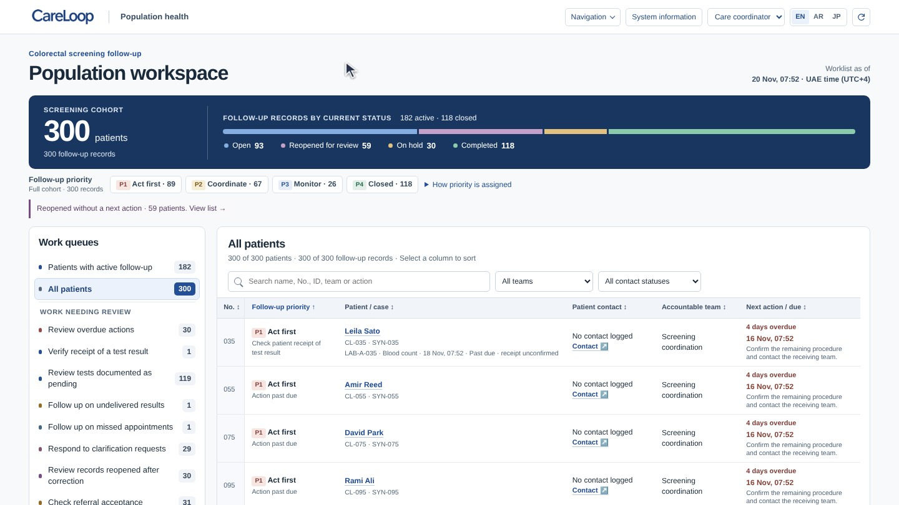

# CareLoop

**Helping screening results lead to the necessary tests and care.**

A test can be complete while the patient is still waiting for the result. A missed appointment can leave a patient unsure who will call to rebook. CareLoop shows which patients need follow-up, the record behind each case, and who is responsible for the next step.

[Open the live demo](https://careloop-demo-864232222461.asia-northeast1.run.app/entry/) · [English demo video (v12, 2 min 59 sec, MP4)](https://raw.githubusercontent.com/solidfdn/careloop/main/assets/careloop-demo-en.mp4) · [Technical briefing (v3.2, PDF)](docs/CareLoop-Technical-Briefing-EN.pdf) · [日本語](README.ja.md)

## Follow the cases in the video

The **v0.5.2 RC32** workspace opens with 300 patients created for this colorectal screening follow-up demo. In a fresh workspace, 182 patients have active follow-up. Select a queue to open its patient list. The same patient may need more than one kind of follow-up.

| Start here | What to look for |
| --- | --- |
| [Undelivered test results · CL-015](https://careloop-demo-864232222461.asia-northeast1.run.app/?lang=en&queue=result_waiting) | Rami Morgan has had a colonoscopy and is waiting for the result. Open the delivery record, then record which team will check with the clinic and contact the patient, and when. |
| [Missed appointments · CL-025](https://careloop-demo-864232222461.asia-northeast1.run.app/?lang=en&queue=missed_appointment) | Omar Sato missed a visit and has no new booking. Record the plan for a call. In the patient view, Omar can ask who will arrange the appointment and read the care team's reply. |
| [Patient worklist](https://careloop-demo-864232222461.asia-northeast1.run.app/?lang=en) | Ask how many patients are waiting for an explanation and open the matching records. After Omar submits his question in the video, the answer identifies 30 of 300 patients. |

The [hands-on guide](docs/demo-guide.md) follows these cases in order. It also shows how a receiving clinic accepts a referral (CL-002), how a corrected report reopens a case while preserving the earlier decision (CL-006), and how to try the PDF import exercise (CL-001). The workspace is also available in [Japanese](https://careloop-demo-864232222461.asia-northeast1.run.app/?lang=ja) and [Arabic](https://careloop-demo-864232222461.asia-northeast1.run.app/?lang=ar).

## How a case reaches closure

CareLoop links source documents, review decisions, the accountable team and the next action. The referring team stays accountable until the receiving team accepts the handoff. The patient can record what needs explaining in their own words, and the care team can reply in the same case.

Gemini helps staff ask questions about the records and identify passages that may need review. Staff can inspect the supporting material, including where a fact is missing or records conflict. The API checks the workflow conditions. A person reviews the evidence and authorizes closure.

## Technical reference

| Document | Purpose |
| --- | --- |
| [Technical briefing v3.2 (PDF, 17 pages)](docs/CareLoop-Technical-Briefing-EN.pdf) | An illustrated walkthrough of the two cases, architecture, validation and pilot scope. |
| [Architecture and evidence lifecycle](docs/architecture.md) | Components, record relationships and the role of AI. |
| [Access, data controls and operation](docs/security-and-operations.md) | Persona permissions, retention, dependencies, capacity and failure handling. |
| [Implementation and review map](docs/reviewer-map.md) | Demonstrated features, their supporting evidence and the planned pilot. |
| [Validation](docs/validation.md) · [Scope and limitations](docs/scope-and-limitations.md) | Technical checks, versions tested and evaluation limits. |
| [PDF exercise files](demo-data/README.md) · [Rights and attribution](NOTICE.md) | Downloadable CL-001 records, file verification and publication terms. |

This repository publishes demonstration videos, documentation, selected illustrations and sample PDFs. Evaluation to date covers developer checks on the demo workflows. Clinical outcomes and staff-time savings remain to be assessed with care teams.

Prepared by [SOLIFAN](https://www.solid-fdn.co.jp/en/) for the Future Health Digital Innovation Challenge, **Challenge 05 — Closing the Screening-to-Care Loop**.
