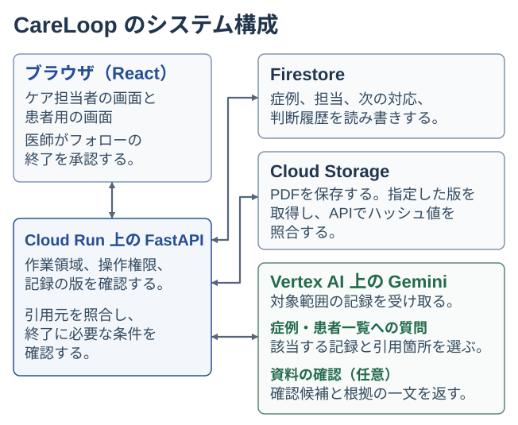

# アーキテクチャと資料・判断の流れ

[ホーム](../README.ja.md) · [English](architecture.md) · [権限・データ管理・運用](security-and-operations.ja.md) · [実装と検証の対応](reviewer-map.ja.md)

CareLoopは、健診後の経路に資料、担当チーム、人の判断を結び付けます。状態と終了条件はAPIで管理し、ブラウザに表示します。Geminiが自然言語の質問と任意の資料確認を支援し、APIが回答を記録の値と出典に結び付けます。

## システム構成

RC32では、FastAPIがFirestoreの症例記録とCloud StorageのPDFを読み書きします。症例や患者一覧について質問すると、Geminiが利用者の閲覧できる記録から該当箇所を選び、APIが照合して根拠付きの回答を返します。フォローの終了は医師が承認し、APIが必要条件を確認して判断を記録します。各操作を確認した版と結果は[検証記録](validation.ja.md)に掲載しています。

| 構成要素 | 役割 | データと境界 |
| --- | --- | --- |
| React / TypeScript / Vite | 一覧・症例への質問、医療者・調整担当・患者の画面。アプリ内配信のPDF.jsで原本を表示 | 3言語で同じ記録を利用。役割切替はデモ上の人物設定。 |
| Cloud Run上のFastAPI | セッション分離、操作権限、版の競合検出、ルール、人の判断、終了条件 | アプリは東京（`asia-northeast1`）に配置。ブラウザ側の表示だけでは終了を承認できない。 |
| Firestore | 症例・作業領域、根拠参照、判断履歴、抽出情報、利用記録を保存 | 症例と作業領域の更新番号で競合を検出。実行用サービスアカウントで接続。 |
| Cloud Storage | PDF原本のバイト列を保持 | 新規作成のみの書込み、世代指定、ハッシュ照合。症例・セッションを確認するAPIを経由して取得。 |
| Vertex AI / Gemini | 自然言語の質問に関連する記録・原文を選択。任意の資料確認では出典付き候補を提示 | 記録上のモデルは `gemini-3.1-flash-lite`、接続先はglobal。状態・DB・終了処理を直接操作しない。 |

AIはAPIから範囲を限定した情報を受け取り、選択結果・候補をAPIへ返します。FirestoreやCloud Storageへ直接接続しません。東京へのアプリ配置とAIのglobal接続は別の設定で、UAE国内だけでのデータ処理は保証していません。SQLとFirestoreエミュレータは開発・試験用で、公開構成の追加DBではありません。

## PDFから判断まで

1. **取込・抽出**：症例・セッション・更新番号を確認し、処理量を制限した `pypdf` で本文を抽出。受理したPDF原本、各ページ、結合本文のハッシュと抽出器の版を分けて記録します。取込だけでは根拠に登録されません。
2. **照合・登録**：担当者が原本と抽出文を比較し、現在のハッシュに対して確認を記録。アラビア語では文字順も確認します。登録は医学的事実の証明ではありません。
3. **関係の指定**：後日の出来事は新しい根拠として追加。誤記の訂正では、同じ症例の現在有効な資料を置換対象に指定。どちらも以前の資料を保持します。
4. **確認・対応**：ルールが原文の関連記載を示し、任意のAIが出典を確認した候補を追加。医療者のデモ役割で、扱い・理由・有効な根拠を記録します。「採用」には未完了の次の対応が必要で、採用だけでは解消扱いになりません。
5. **確認・終了**：人が実施根拠、結果と次方針、説明、対応完了を記録。APIは現在の確認結果と必要条件がそろった場合に終了を受け付けます。
6. **変更後の再確認**：訂正を含む新しい臨床資料の追加で、実施根拠・結果確認・方針説明が失効。終了済みなら `review_required` に戻ります。古い資料集合に結び付いた判断も再確認が必要となり、以前の判断は履歴に残ります。

[操作ガイド](demo-guide.ja.md)では、検査結果が患者に届いていないCL-015と、予約日に来院せず次の予約も入っていないCL-025を扱います。訂正の例はCL-006です。診察のみだったとの訂正で3項目が再確認となり、以前の終了判断は履歴に残ります。CL-001ではPDFを取り込み、後から報告を訂正する操作を試せます。

## 記録と参照関係

以下は論理的な記録単位であり、各行が独立したDBテーブルであるという意味ではありません。

| 記録 | 主な項目・参照 | 意味 |
| --- | --- | --- |
| 作業領域 | 有効期限、更新番号、デモ用に作成した300人の初期リスト | 記録は審査員のセッションごとに保存します。 |
| 症例 | 患者参照、更新番号、現担当・候補先、経路、状態、次の対応 | 責任と未完了事項を保持。 |
| PDF抽出 | 原本ハッシュ・世代、ページ本文とハッシュ、抽出器と版 | 原本と抽出文を別々に照合。 |
| 根拠 | ID、本文ハッシュ、版、`supersedes`、PDF参照、照合記録 | 原本を上書きせず有効な資料集合を変更。 |
| 確認候補と判断 | 根拠ID、引用、資料ハッシュ、扱い、理由、操作者、更新番号 | 根拠変更後に過去の判断を自動流用しない。 |
| 確認・終了 | 実施資料、解消理由、結果確認、説明、経路・版 | 受診・予約・別方針の終了と通常完了を区別。 |
| 履歴 | 操作、時刻、デモ役割、更新番号、前イベントのハッシュ | 過去の操作を追跡。外部の改ざん不能な認証基盤ではない。 |

PDFの引用にはページ番号と文字位置も付与できます。ハッシュは原文の整合性を確認するもので、発行者の本人性や医学的な正しさを証明しません。

## Geminiによる自然言語での記録確認

担当者は、選択した症例または権限内の一覧について、英語・日本語・アラビア語で質問できます。たとえば「なぜ再確認が必要になった？」「どの確認が残っている？」「次の対応は誰が、いつ行う？」を確認できます。

1. サーバーがセッション、症例または一覧の絞込み範囲を確定し、記録のブロック、集計値、参照元の一覧を用意します。個別資料の参照量には上限があり、回答に対象範囲を示します。
2. Geminiが自由文の意図を読み取り、言い換えや複合質問も含め、渡された記録・原文のIDを選びます。事実・項目名・日時・件数・引用文をモデルが作り直す方式ではありません。
3. サーバーが選択結果を検証し、記録上の値と原文から回答を構成します。参照元では有効な資料と訂正前の資料を区別し、訂正と過去の人の判断を結び付けます。回答には記録の確認時点と参照範囲を表示します。
4. 情報不足、出典の矛盾、対応範囲外の質問を示します。確認が失効しているだけでは、実際に診療が行われなかったと断定しません。その説明には資料の記載が必要です。
5. 質問で症例記録を更新したり、終了を承認したりしません。回答中に記録が変わると、古い結果は返さず再確認を求めます。AIの実行・利用量は症例記録とは別に記録します。

一覧で患者数を質問すると、閲覧・絞り込みの対象に含まれる患者IDを重複なく数えます。回答から該当するフォロー記録を開けます。P1〜P4が示すのは記録の件数で、同じ患者の複数のフォローも含みます。患者や症例を指定した質問では対象範囲から該当記録を探し、質問に関係する資料を参照します。一覧への質問は担当者の役割で利用できます。

## 任意の資料確認：AIの入力・出力・権限

| 段階 | 実装上の扱い |
| --- | --- |
| 入力 | 有効な根拠のID・題名・本文・版・時刻と説明言語。現在も有効な人の解消判断を含める場合がある。この本文分析ではPDF原本のバイト列を送らない。 |
| 出力 | 根拠ID・原文引用・説明を含む構造化データ。形式、引用の存在、文脈・言語をサーバーで確認。 |
| 人の判断 | `adopted`（採用）、`resolved`（解消）、`not_applicable`（対象外）を理由と有効な根拠とともに記録。採用だけでは対応完了にならない。 |
| 権限 | AIは症例状態を更新せず、診断・治療・緊急度・終了を決定しない。通常のプログラム処理で条件を強制。 |
| 失敗時 | 不正・不完全な応答はエラーとし、候補ゼロの正常終了に置き換えない。候補ゼロも臨床的な完備性を意味しない。 |

資料確認と終了条件の操作は、Geminiを呼ばずルールで実施できます。自然言語の質問には設定済みのGemini接続が必要です。ルール、質問回答、AI候補は確認の補助で、臨床的に検証された判定器ではありません。

## 業務上の規則

画面の6項目は、本人への案内確認、医療者への相談、実施根拠、結果確認、次方針の説明、紹介の引受です。APIは加えて、責任者、引継ぎ待ち、経路の版、保留、次の対応、未解消の資料・AI候補を確認します。古い更新番号での確認結果では終了できません。

| 出来事 | 必要な動作 |
| --- | --- |
| 引継ぎの依頼 | 受入れまで現担当を保持。 |
| 保留 | 理由・担当・次の対応・再確認日時を保持し、通常終了は不可。 |
| 辞退・代替方針 | 根拠を伴う別の終了区分を使用し、元の検査を実施済みにしない。 |
| 患者の追加説明希望 | 希望を保持して方針説明を再確認。理解したという自己申告で終了を承認しない。 |
| 古い画面からの更新 | 競合として拒否。最新状態を読み直して判断する。 |

## 言語と時刻

v0.5.2画面では、日本語の予定日時は **Asia/Tokyo（UTC+9）**、英語・アラビア語は **Asia/Dubai（UTC+4）** です。予定値はタイムゾーン付きのUTCにして保存します。言語切替はアップロードした原本や利用者の原文を改変しません。アラビア語は右から左のレイアウトに対応し、医療表現の専門レビューは未実施です。

操作は[試用ガイド](demo-guide.ja.md)、権限・保存・保持と運用上限は[権限・データ管理・運用](security-and-operations.ja.md)を参照してください。
