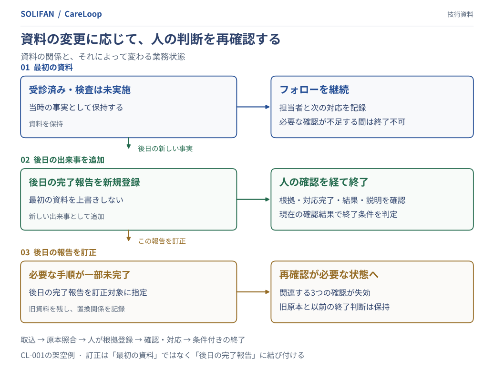

# アーキテクチャと資料・判断の流れ

[ホーム](../README.ja.md) · [English](architecture.md) · [権限・データ管理・運用](security-and-operations.ja.md) · [実装と検証の対応](reviewer-map.ja.md)

CareLoopは、健診後の経路に原資料、担当チーム、人の判断を結び付けます。状態と終了条件はAPIで管理し、ブラウザに表示します。任意のAI支援は、人が確認する候補を提示します。

## システム構成

図は公開試作の構成を示しています。実装詳細は保存済みの **v0.4.11** ソースと照合しました。公開画面は **v0.4.12** で、直近の画面変更は日本語の記録・予定日時に関するものです。

| 構成要素 | 役割 | データと境界 |
| --- | --- | --- |
| React / TypeScript / Vite | 医療者・調整担当・患者の画面。アプリ内配信のPDF.jsで原本を表示 | 3言語で同じ記録を利用。役割切替はデモ上の人物設定。 |
| Cloud Run上のFastAPI | セッション分離、操作権限、版の競合検出、ルール、人の判断、終了条件 | アプリは東京（`asia-northeast1`）に配置。ブラウザ側の表示だけでは終了を承認できない。 |
| Firestore | 症例・作業領域、根拠参照、判断履歴、抽出情報、利用記録を保存 | 症例と作業領域の更新番号で競合を検出。実行用サービスアカウントで接続。 |
| Cloud Storage | PDF原本のバイト列を保持 | 新規作成のみの書込み、世代指定、ハッシュ照合。症例・セッションを確認するAPIを経由して取得。 |
| Vertex AI / Gemini（任意） | 原文引用を伴う確認候補を提示 | 記録上のモデルは `gemini-3.1-flash-lite`、接続先はglobal。状態・DB・終了処理を直接操作しない。 |

実線は通常の処理、破線は利用者が選ぶAI呼出しです。東京へのアプリ配置とAIのglobal接続は別の設定で、UAE国内だけでのデータ処理は保証していません。SQLとFirestoreエミュレータは開発・試験用で、公開構成の追加DBではありません。

## PDFから判断まで

1. **取込・抽出**：症例・セッション・更新番号を確認し、処理量を制限した `pypdf` で本文を抽出。受理したPDF原本、各ページ、結合本文のハッシュと抽出器の版を分けて記録します。取込だけでは根拠に登録されません。
2. **照合・登録**：担当者が原本と抽出文を比較し、現在のハッシュに対して確認を記録。アラビア語では文字順も確認します。登録は医学的事実の証明ではありません。
3. **関係の指定**：後日の出来事は新しい根拠として追加。誤記の訂正では、同じ症例の現在有効な資料を置換対象に指定。どちらも以前の資料を保持します。
4. **確認・対応**：ルールが原文の関連記載を示し、任意のAIが出典を確認した候補を追加。医療者のデモ役割で、扱い・理由・有効な根拠を記録します。「採用」には未完了の次の対応が必要で、採用だけでは解消扱いになりません。
5. **確認・終了**：人が実施根拠、結果と次方針、説明、対応完了を記録。APIは現在の確認結果と必要条件がそろった場合に終了を受け付けます。
6. **変更後の再確認**：訂正を含む新しい臨床資料の追加で、実施根拠・結果確認・方針説明が失効。終了済みなら `review_required` に戻ります。古い資料集合に結び付いた判断も再確認が必要となり、以前の判断は履歴に残ります。

CL-001では「受診したが検査未実施」「後日の完了報告」「その後日の報告の訂正」を保持します。訂正対象は後日の報告であり、当時の事実を正しく記録した最初の資料ではありません。

## 記録と参照関係

以下は論理的な記録単位であり、各行が独立したDBテーブルであるという意味ではありません。

| 記録 | 主な項目・参照 | 意味 |
| --- | --- | --- |
| 作業領域 | 有効期限、更新番号、架空の4症例 | セッションごとに複製。期限切れと削除は別。 |
| 症例 | 患者参照、更新番号、現担当・候補先、経路、状態、次の対応 | 責任と未完了事項を保持。 |
| PDF抽出 | 原本ハッシュ・世代、ページ本文とハッシュ、抽出器と版 | 原本と抽出文を別々に照合。 |
| 根拠 | ID、本文ハッシュ、版、`supersedes`、PDF参照、照合記録 | 原本を上書きせず有効な資料集合を変更。 |
| 確認候補と判断 | 根拠ID、引用、資料ハッシュ、扱い、理由、操作者、更新番号 | 根拠変更後に過去の判断を自動流用しない。 |
| 確認・終了 | 実施資料、解消理由、結果確認、説明、経路・版 | 受診・予約・別方針の終了と通常完了を区別。 |
| 履歴 | 操作、時刻、デモ役割、更新番号、前イベントのハッシュ | 過去の操作を追跡。外部の改ざん不能な認証基盤ではない。 |

PDFの引用にはページ番号と文字位置も付与できます。ハッシュは原文の整合性を確認するもので、発行者の本人性や医学的な正しさを証明しません。

## AIの入力・出力・権限

| 段階 | 実装上の扱い |
| --- | --- |
| 入力 | 有効な根拠のID・題名・本文・版・時刻と説明言語。現在も有効な人の解消判断を含める場合がある。この本文分析ではPDF原本のバイト列を送らない。 |
| 出力 | 根拠ID・原文引用・説明を含む構造化データ。形式、引用の存在、文脈・言語をサーバーで確認。 |
| 人の判断 | `adopted`（採用）、`resolved`（解消）、`not_applicable`（対象外）を理由と有効な根拠とともに記録。採用だけでは対応完了にならない。 |
| 権限 | AIは症例状態を更新せず、診断・治療・緊急度・終了を決定しない。通常のプログラム処理で条件を強制。 |
| 失敗時 | 不正・不完全な応答はエラーとし、候補ゼロの正常終了に置き換えない。候補ゼロも臨床的な完備性を意味しない。 |

主な試用はルールのみで実施できます。ルールとAIは資料確認の補助で、臨床的に検証された判定器ではありません。

## 業務上の規則

画面の6項目は、本人への案内確認、医療者への相談、実施根拠、結果確認、次方針の説明、紹介の引受です。APIは加えて、責任者、引継ぎ待ち、経路の版、保留、次の対応、未解消の資料・AI候補を確認します。古い更新番号での確認結果では終了できません。

| 出来事 | 必要な動作 |
| --- | --- |
| 引継ぎの依頼 | 受入れまで現担当を保持。 |
| 保留 | 理由・担当・次の対応・再確認日時を保持し、通常終了は不可。 |
| 辞退・代替方針 | 根拠を伴う別の終了区分を使用し、元の検査を実施済みにしない。 |
| 患者の追加説明希望 | 希望を保持して方針説明を再確認。理解したという自己申告で終了を承認しない。 |
| 古い画面からの更新 | 競合として拒否。最新状態を読み直して判断する。 |

## 言語と時刻

確認済みのv0.4.12画面では、日本語の予定日時は **Asia/Tokyo（UTC+9）**、英語・アラビア語は **Asia/Dubai（UTC+4）** です。予定値はタイムゾーン付きのUTCにして保存します。言語切替はアップロードした原本や利用者の原文を改変しません。アラビア語は右から左のレイアウトに対応し、医療表現の専門レビューは未実施です。

操作は[試用ガイド](demo-guide.ja.md)、権限・保存・保持と運用上限は[権限・データ管理・運用](security-and-operations.ja.md)を参照してください。
