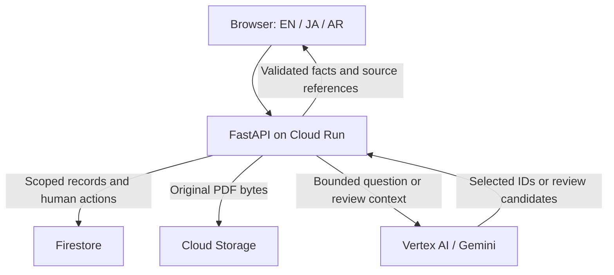
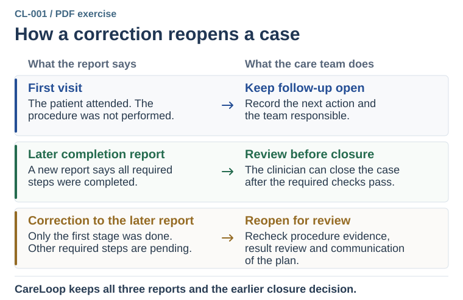

# Architecture and evidence lifecycle

[Home](../README.md) · [日本語](architecture.ja.md) · [Controls and operations](security-and-operations.md) · [Implementation and evidence](reviewer-map.md)

CareLoop connects source documents, accountable teams and human decisions in a screening follow-up pathway. The API owns the workflow state and closure checks. The browser presents the record. Gemini supports natural-language questions and optional evidence review; the API binds answers to recorded facts and sources.

## System architecture

The v0.5.2 RC32 service uses this architecture for both individual cases and worklist questions. The [validation record](validation.md) identifies the release tested for each workflow.

| Component | Responsibility | Data or boundary |
| --- | --- | --- |
| React / TypeScript / Vite | Worklist and case questions, care-team and patient views, PDF comparison with locally served PDF.js assets | Shared records across English, Japanese and Arabic. The role selector chooses a demo persona. |
| FastAPI on Cloud Run | Session scoping, role/action and revision checks, rules, decisions and closure | Application hosted in Tokyo (`asia-northeast1`). Browser state cannot authorize closure. |
| Firestore | Case/workspace state, evidence references, decision history, extraction metadata and resource records | Case and workspace revisions detect conflicting changes. Runtime access uses a service account. |
| Cloud Storage | Original PDF bytes | Create-only uploads, pinned object generations and hash checks. Originals are retrieved through the scoped API. |
| Vertex AI / Gemini | Select relevant records and original passages for natural-language questions; optionally propose source-linked review items | Documented model: `gemini-3.1-flash-lite`; global endpoint. No direct workflow, database or closure access. |

The model receives bounded context from the API and returns selections or candidates to that API. It has no direct connection to Firestore or Cloud Storage. Tokyo hosting and global model routing are separate settings. UAE-only data residency is not claimed. SQL and the Firestore emulator are test/development backends, not additional databases in this deployment.

## From a PDF to a decision

1. **Import and extract.** Check the case/session and expected revision. A bounded `pypdf` worker extracts page text. Store an accepted PDF with its original hash; record page hashes, joined-text hash and extractor version separately. Import alone does not register case evidence.
2. **Compare and register.** A reviewer compares original and extracted text and confirms the current hashes. Arabic text also requires an order check. Registration links the evidence to its original; it does not establish clinical truth.
3. **Choose the relationship.** Add a later event as new evidence. A correction instead names the active same-case report it supersedes. Preserve earlier documents in both cases.
4. **Review and act.** Rules identify source wording; optional AI adds validated, source-linked candidates. A clinician persona records the decision, reason and active-source references. Adopting an item requires an open next action and does not resolve it.
5. **Confirm and close.** Record procedure evidence, result/plan review, explanation and action completion. The API requires a current review and all applicable conditions before accepting closure.
6. **Reconsider changes.** Adding clinical evidence, including a correction, clears procedure, result-review and plan-communication confirmations. A closed case becomes `review_required`. Decisions bound to an older source set need renewed review; previous decisions remain in history.

The [walkthrough](demo-guide.md) follows a test result that has not reached the patient (CL-015) and a missed appointment with no replacement booking (CL-025). A separate correction example, CL-006, shows how a report that only a consultation took place invalidates three confirmations while preserving the previous closure. CL-001 provides the PDF import and correction exercise.

## Records and relationships

The following table describes logical application records.

| Record | Main fields and links | Purpose |
| --- | --- | --- |
| Workspace | Expiry, revision and a starting list of 300 patients created for the demo | Each reviewer session has its own records. |
| Case | Patient reference, revision, current/pending owner, pathway, status, next action | Preserve responsibility and unfinished work. |
| PDF extraction | Original hash/generation, page text and hashes, extractor/version | Check originals and extracted text independently. |
| Evidence | ID, text hash, version, `supersedes`, PDF reference, comparison record | Change active sources without overwriting originals. |
| Review item and decision | Evidence ID, quote, source hashes, disposition, reason, actor, revision | Do not silently reuse a decision after supporting sources change. |
| Confirmation and closure | Procedure source, reconciliation reason, result review, explanation, pathway/revision | Distinguish completion from a visit, booking or alternative disposition. |
| History | Action, time, demo role, revision, previous-event hash | Trace earlier actions; not external tamper-proof certification. |

PDF quotations can carry page numbers and character offsets. A hash checks byte/text consistency; it does not authenticate a report issuer or prove a medical finding.

## Natural-language questions with Gemini

Staff can ask about the selected case or the authorized worklist in English, Japanese or Arabic. Examples include “Why does this case need review again?”, “Which checks are outstanding?” and “Who owns the next action, and when is it due?”

1. The server applies the session, case or worklist-filter scope and builds record blocks, computed totals and a source catalog. Individual source detail is bounded; the answer reports coverage limits.
2. Gemini interprets the free-text question, including paraphrases and combined questions, and selects supplied block IDs and original-passage IDs. It does not supply replacement facts, labels, dates, counts or invented quotations.
3. The server validates those selections and composes the answer from recorded values and exact source passages. References distinguish active and superseded evidence and connect the correction with the earlier human decision. The answer displays the records-checked time and source scope.
4. Missing information, conflicting sources and unsupported requests are surfaced. A currently invalid confirmation is not proof that care did not occur; such a statement must come from an identified source.
5. Asking a question does not change case records or authorize closure. The server checks for record changes during answering and rejects a stale result. AI execution and resource-use records are recorded separately.

Worklist questions count distinct patient identifiers across the authorized selection. An answer can open the matching follow-up records. P1–P4 count follow-up records, so one patient can contribute more than one. A question naming a patient or case searches the authorized selection for that identifier. Source detail is bounded by the question context. Only staff personas can ask about the worklist.

## Optional evidence review: input, output and authority

| Stage | Implemented behaviour |
| --- | --- |
| Input | Active evidence IDs, titles, text, versions and timestamps, with the requested explanation language. A still-current human reconciliation can be included. This text-analysis path does not send original PDF bytes. |
| Output | Structured findings with an evidence ID, quotation and message. The server validates schema, quotation membership, and context/language requirements. |
| Human decision | `adopted`, `resolved` or `not_applicable`, with reasons and active-source references. Adoption does not complete the action. |
| Authority | The model cannot write case state, decide diagnosis/treatment/urgency, or approve closure. The deterministic workflow enforces requirements. |
| Failure | Invalid or incomplete output is an error, not an empty successful review. Zero findings does not establish completeness. |

The evidence and closure workflow can use rules without Gemini. Natural-language questions require the configured Gemini service. Neither source matching, question answers nor review proposals are clinically validated classifiers.

## Workflow rules

The six visible checks cover patient acknowledgement, clinician consultation, procedure evidence, result review, plan communication and accepted referral. The API also checks owner, pending handoff, supported pathway, hold status, open next action and unresolved source/AI items. An older revision's review cannot authorize closure.

| Event | Required behaviour |
| --- | --- |
| Handoff request | Keep the current owner until the pending recipient accepts. |
| Hold | Keep a reason, owner, next action and scheduled review; block normal completion. |
| Decline or alternative plan | Use a distinct, evidence-backed disposition; do not mark the original procedure performed. |
| Patient requests clarification | Retain the request and require renewed plan communication. Self-reported understanding does not authorize closure. |
| Stale or concurrent update | Reject with a revision conflict; reload before deciding against the new state. |

## Language and time

In the v0.5.2 interface, Japanese schedules use **Asia/Tokyo (UTC+9)**; English and Arabic use **Asia/Dubai (UTC+4)**. Schedules are stored as timezone-aware UTC values. Localization does not rewrite uploaded originals or a user's original-language message. Arabic uses right-to-left layout; specialist-language validation is outstanding.

See the [hands-on guide](demo-guide.md) for the walkthrough and [controls and operations](security-and-operations.md) for access, retention and deployment limits.
