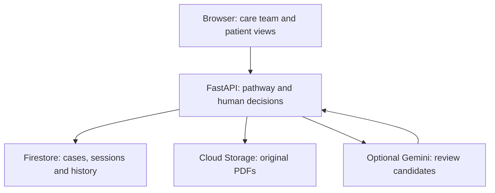

# Technical architecture

[Home](../README.md) · [Validation](validation.md)

CareLoop is a browser-based synthetic workflow prototype. The documented deployment uses a React/TypeScript interface, a FastAPI service on Cloud Run, Firestore for persistent records and Cloud Storage for PDF originals. Optional Gemini requests use Vertex AI.

The service is hosted in Tokyo. Model requests can use global routing. These are distinct settings; UAE-only data residency is not claimed.

## Evidence and decisions

PDF originals, extracted text, source references and human decisions are separate records. Before registration, a reviewer compares the extracted page with the original. A source fingerprint connects subsequent decisions to their supporting content.

A later event can be added without rewriting the earlier report. A correction identifies the report it replaces. When supporting evidence changes, dependent confirmations require reconsideration, and the case can return to review. Earlier source versions and the earlier closure remain available.

The closure checklist covers patient acknowledgement, clinical consultation, procedure evidence, clinician result review, plan communication and referral acceptance. The workflow also checks current evidence, required action completion and relevant review-item decisions. A successful phrase match does not establish that a real procedure occurred.

## Rules, AI and people

Rules identify explicit source wording and workflow requirements. Optional Gemini support proposes source-linked items for review. Reviewers inspect the original context, decide how to handle each item and record reasons. Adoption of an item is separate from completion of its next action. The service controls closure; the model cannot authorize it.

## Session and update controls

A browser session operates on a separate copy of four fictional cases. Tabs within one browser profile share the session. Session expiry and bounded resource use limit the public exercise. Demo role selection is a persona switch, not clinical authentication.

Updates use revision checks to reject conflicting writes. Source-bound human judgments, retained history and checks against current evidence keep earlier decisions distinguishable from the current state. PDF imports and model requests have bounded resource use.

## Localization and dates

The interface supports English, Japanese and Arabic, including right-to-left layout. In v0.4.12, Japanese scheduling uses Asia/Tokyo; English and Arabic use Asia/Dubai. The displayed time zone must be used when entering a schedule. Original document content remains identifiable as source material, including when it differs from the interface language.

The sample pathway and schedule are demonstration settings. Institution-specific clinical deadlines and real provider integration are outside this prototype. See [scope and limitations](scope-and-limitations.md).
