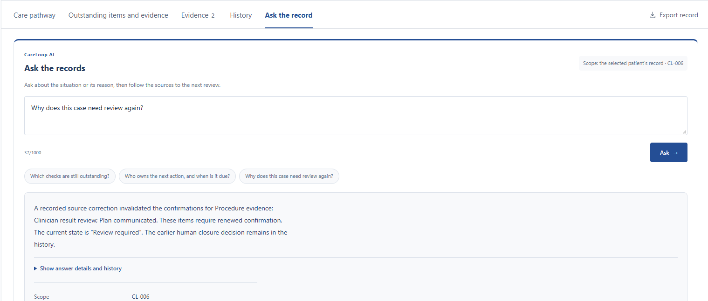

# CareLoop 試用ガイド

[ホーム](../README.ja.md) · [English](demo-guide.md) · [デモ動画](https://youtu.be/y_zqr-R8R3g)

完成した実演動画と同じ **CL-006 / Kenji Morgan / SYN-006** を確認します。訂正資料を読み、再確認の理由を自然言語で質問し、根拠から担当者と次の対応へ進みます。現行アプリは **v0.5.2（RC9）** です。入力には合成データを使用してください。

## 実演と同じ症例を開く

1. [日本語のアプリ](https://careloop-demo-864232222461.asia-northeast1.run.app/?lang=ja)を開き、**操作役割**を **フォロー担当者** にします。
2. 新しい作業領域は4件から始まります。**CL-006** がない場合は、一覧の **300名規模で確認** を押します。元の4件を残して実演用の記録が追加されます。すでに300件ある場合は、そのまま次へ進みます。
3. **すべて**を選び、絞込み条件を解除して **CL-006** を検索し、**Kenji Morgan** を開きます。

独立した試用には別のブラウザプロファイルかプライベートウィンドウを使用します。同じプロファイルのタブは作業を共有します。試用領域の有効期間は24時間で、期限切れの場合は画面に表示される **新しい作業を開始** を使います。**一覧に戻る** はデータを初期化せず一覧へ戻る操作です。日付・件数・更新番号は、作成時点や後の操作によって変わります。操作役割の切替は試用用で、資格や本人確認を示すものではありません。

## 1. 以前の終了判断と訂正資料を確認する

**履歴**を開き、以前の終了判断と、その後の資料追加について詳細を確認します。以前の終了判断は、その時点の判断として保持されています。

**判断材料**で **検査完了報告の訂正**（英語原題：Correction to procedure completion report、`EV-SCALE-006-02`）を開きます。訂正対象は `EV-SCALE-006-01` です。原文には次の記載があります。

> Patient SYN-006. Correction: consultation only. Required procedure not performed. Rebooking required.

診察のみで、必要な検査は未実施、再予約が必要という内容です。以前の報告も、訂正前の資料として確認できます。この症例では原資料が未実施を明記しています。確認欄が未確認であることだけから、実際のケアが行われなかったとは判断しません。

## 2. 確認し直す項目を見る

**残っていることと根拠**を開き、6つの必要な確認の現在状態を確認します。

| 確認項目 | CL-006の開始状態 |
| --- | --- |
| 患者の確認 | 確認済み |
| 医療者への相談 | 確認済み |
| 検査の実施根拠 | 以前の確認が失効 |
| 医師の結果確認 | 以前の確認が失効 |
| 次の方針の説明 | 以前の確認が失効 |
| 紹介先の引受 | 確認済み |

6項目中3項目が有効な状態です。**対応の流れ**にも3/6と、以前の終了記録が表示されます。状態は **再確認が必要** です。再び終了するには、現在の終了条件を満たし、医療者が判断する必要があります。

## 3. Geminiを使って記録に質問する

**記録に質問**を開き、次のように入力します。

**なぜ再確認が必要になりましたか？**

**質問する**を押します。簡潔な回答を読み、**回答の根拠**と **記録の確認時点** を確認します。詳細が必要な場合は **回答の詳細と履歴を開く** を使用します。参照リンクから、関連する原資料や履歴へ進めます。

別の自然言語の質問も試せます。

- **この患者には、どの確認が残っていますか？**
- **現在の担当者と次の対応予定は？**

Geminiが質問の意図を読み取り、渡された記録と原文から関連箇所を選びます。システムは記録上の値、参照元、確認時点を結び付けて回答します。情報不足や有効な資料の矛盾も示します。質問によって文面が変わる場合は、回答に含まれる事実と参照元を確認してください。質問では症例の記録を変更せず、操作の承認も行いません。

記録が更新された場合は、最新の状態で質問し直します。AI接続や利用枠の問題がある場合はその状態を表示し、原資料と履歴の閲覧は引き続き利用できます。

## 4. 誰が次に対応するかを確認する

**残っていることと根拠**で、現在の担当、引受待ち、次の対応を確認します。

CL-006の開始状態では **フォロー担当A** が責任を持ち、引受待ちはなく、次の対応予定は未登録です。CareLoopは未登録であることを示し、具体的な対応は担当者が判断して別途記録します。

引継ぎのルールを見る場合は **CL-002** を確認します。引継ぎ先が受け入れるまで現在の担当者に責任が残り、依頼しただけでは担当責任は移りません。

## 5. 患者側の画面を確認する

対象症例を選択した状態で **患者への案内** を開きます。次の行動、相談先、届いている資料を確認できます。回答の記録を試す場合は、**操作役割**を **患者** に切り替え、**次にすることを理解しました** または **もう少し説明してほしい** を選び、必要に応じて補足を入力して **回答を記録** を押します。

この任意の操作は回答を保存し、症例の更新番号も変えます。案内を読んだ記録と、理解した／追加説明が必要という回答は別に扱います。患者の回答によって、未完了の検査を実施済みとすることはありません。担当者側へ戻る場合は **フォロー担当者** に切り替えます。

## 一覧全体への質問

**一覧に戻る**を押します。一覧の質問欄では、**全体の記録** または **現在の一覧条件に合う記録** を選んでから、**要確認のフォローは何件ありますか？**、**期限を過ぎた次の対応はありますか？** などと質問できます。

件数は、表示された対象範囲・期間にあるフォロー記録の集計です。該当する記録が多い場合は個別説明の対象が限られるため、条件を絞るか症例を開いて根拠を確認します。記録件数を、実在する患者の重複を除いた人数として扱わないでください。

## 任意のPDF取込み・終了演習：CL-001

公開している2つのPDFは、別の症例 **CL-001 / Alex Morgan / SYN-001** 用です。CL-006へ取り込まないでください。この演習では、完了報告の追加、終了、訂正を順に操作できます。上のCL-006の主な手順では、準備済みの経緯を確認します。

- **操作役割**を **医療者** にし、**CL-001** を開きます。すでに変更した症例であれば、独立した作業領域で開始状態を確認します。
- [後日の完了報告](https://github.com/solidfdn/careloop/raw/refs/heads/main/demo-data/CareLoop_Demo_Completed_SYN001_v1.pdf)と[訂正報告](https://github.com/solidfdn/careloop/raw/refs/heads/main/demo-data/CareLoop_Demo_Correction_SYN001_v1.pdf)をそのまま使用します。[資料の詳細](../demo-data/README.md)に旧版の識別情報とハッシュを掲載しています。
- 日本語の予定日時は **日本時間（UTC+9）**、英語・アラビア語は **アブダビ時間（UTC+4）** です。画面の時間帯に従い、将来のデモ用日時を設定します。臨床上の期限を意味しません。

### 1. 最初の資料を確認する

**CL-001**を選び、**判断材料**で最初の受診報告を開きます。「相談のみ」「大腸内視鏡検査は未実施」「再予約が必要」という記載を確認します。英語の原資料が表示される場合は、原文の該当箇所を確認します。

**対応の流れ**に戻り、**照合方法**を**ルール照合**にして、**根拠を照合**を押します。引用箇所と終了前の確認を見ます。受診済みであっても必要な検査の完了とは限らず、確認が不足する間は終了できません。

### 2. 次の対応を登録する

**次の対応を登録**を開き、担当者、具体的な対応、予定日時を入力します。例は次のとおりです。

| 項目 | 架空の入力例 |
| --- | --- |
| 次の対応を行う担当 | 検診フォロー担当 |
| 次に行うこと | SYN-001の後日の検査報告書を入手し、内容を確認する。 |
| 予定日時（日本時間） | 将来のデモ用日時。 |

**記録する**を押し、保存された担当・対応・日時を確認します。

### 3. 後日の完了報告を新しい資料として追加する

**判断材料**で `CareLoop_Demo_Completed_SYN001_v1.pdf` を取り込みます。抽出されたページと原本を開き、患者参照番号と記載全体を比較します。

資料名を「後日の検査完了報告 - SYN-001」などにします。訂正対象は指定せず、**新しい判断材料として追加**する選択のまま、比較を行った旨を確認して登録します。登録完了の表示を待ちます。

これは後日に行われた出来事の追加です。以前の未実施という記録は、その時点の事実として残します。

### 4. 人による確認を記録する

**対応の流れ**に戻り、順に記録します。

1. **検査実施を確認**：根拠に後日の完了報告を選び、以前の未完了事項がその後の資料でどう解消したかを説明し、確認して保存します。
2. 次の対応の完了操作：依頼した報告書を入手・確認したことと、その根拠を記録します。
3. **結果・方針を確認**：架空の工程として結果・方針の確認を記録します。
4. **説明を記録**：架空の説明記録を保存します。

実在の臨床所見や患者への連絡があったように記載せず、工程のデモであると明記します。終了前の6項目を確認してください。初期症例には、その他の確認項目が試用用に設定されています。

### 5. 最新の資料を照合し、終了する

変更後に**根拠を照合**を実行します。v0.4.12でこの手順をルール照合のみで検証した際、確認候補は0件でした。**確認候補と判断**が0件であれば、候補への判断は不要です。終了前の6項目の確認は引き続き必要です。

確認候補が表示された場合は、次のように操作します。

1. 各引用をリンク先の原資料と比較し、**候補を確認して判断**を開きます。
2. **候補の扱い**で、資料から解消を確認できる場合は**解消済み**、その症例に当てはまらない場合は**対象外**、対応が必要な場合は**対応中**を選びます。**対応中**を選ぶ前に、担当者と未完了の次の対応を登録します。採用だけでは解消にも終了にもなりません。
3. **判断に使った有効な資料**を選び、**判断した理由・確認内容**を入力して、**判断を保存**を押します。現在有効な原資料に基づいて判断します。

必要な確認と候補への判断が揃ったら、**対応を完了する**を開き、架空の終了理由と確認を記録します。完了状態と終了判断が保存されます。

Geminiの利用は任意です。使用する場合は**Gemini + ルール照合（臨床未検証）**を選び、**AIの実行記録**と提案の根拠を確認します。候補が0件の場合もあります。このPDF演習はルール照合のみでも確認できます。自然言語での質問には、設定済みのGemini接続を使用します。

### 6. 後日の完了報告を訂正する

**判断材料**で `CareLoop_Demo_Correction_SYN001_v1.pdf` を取り込み、原本と抽出文を比較します。「最初の段階のみ実施され、必要な残りの工程は未完了」という訂正文を確認します。

資料名を入力し、**手順3で登録した後日の完了報告**を訂正対象に選んで登録します。

### 7. 変化した状態と、残っている記録を確認する

**対応の流れ・判断材料・履歴**を確認し、もう一度**根拠を照合**します。

- 再確認が必要な状態に戻る。
- 訂正が後日の完了報告と結び付き、その報告が差し替え済みと分かる。
- 検査の実施根拠・医師の結果確認・次の方針の説明が再確認対象になる。検証した手順では6項目中3項目の確認が有効な状態になる。
- 訂正後の未完了事項が解消するまで終了できない。
- 以前のPDFと終了判断は引き続き確認できる。

未完了と記載された資料を根拠に、完了を再確認しないでください。

[検証結果](validation.ja.md)には実施版・日付・範囲を記載しています。[実装範囲・制約](scope-and-limitations.ja.md)も参照できます。
