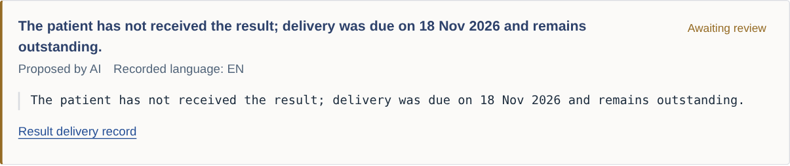
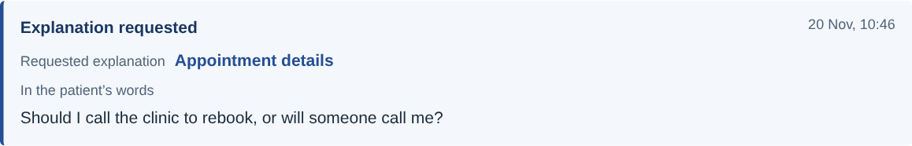
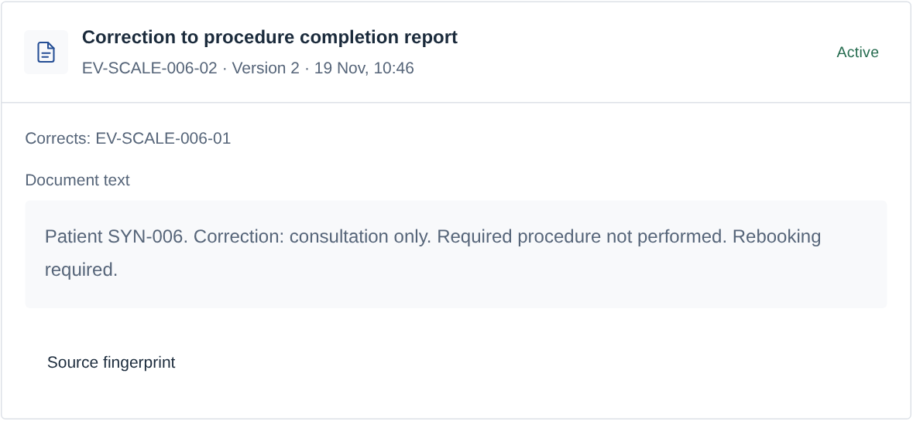

# CareLoop hands-on guide

[Home](../README.md) · [日本語](demo-guide.ja.md) · [English walkthrough](https://raw.githubusercontent.com/solidfdn/careloop/main/assets/careloop-demo-en.mp4) · [Live demo](https://careloop-demo-864232222461.asia-northeast1.run.app/entry/)

Open the [English workspace](https://careloop-demo-864232222461.asia-northeast1.run.app/?lang=en) as **Care coordinator**. The RC32 worklist contains 300 patients created for this colorectal screening follow-up demo. In a fresh workspace, 182 have active follow-up. Select a work queue to see its patients. A patient can appear in several queues. P1–P4 count follow-up records by priority.

Use this workspace for the whole walkthrough. Changes are saved in the browser’s reviewer session and messages stay in CareLoop. For a fresh run, use a new browser profile or private session. Tabs in the same session share the changes. The reviewer session lasts 24 hours.

## Follow a test result that has not reached the patient

1. Open [Follow up on undelivered results](https://careloop-demo-864232222461.asia-northeast1.run.app/?lang=en&queue=result_waiting) and select **Rami Morgan (CL-015)**.
2. Open **Result delivery record** under the patient’s name. The colonoscopy was performed, the expected delivery date has passed, and the patient has not received the result. The video follows the same link from a Gemini review candidate to the supporting passage.
3. Open **Care pathway** and find **Next action and pathway**. There is already an open action. Once the work it describes is done in your exercise, use **Complete next action** and record what was done. Use **Record next action** to save the team, the next step and its scheduled time. The video assigns **Screening coordination** to check delivery with the clinic and contact the patient. Read back the saved plan.

To see how ownership changes, open **CL-002 / Samira Noor** from the patient list. Before acceptance, Screening coordination is responsible for the referral. Select **Accept handoff** and check that **Specialist clinic B** is now accountable and follow-up is still open.

## Follow a missed appointment through to the patient’s reply

1. Open [Follow up on missed appointments](https://careloop-demo-864232222461.asia-northeast1.run.app/?lang=en&queue=missed_appointment) and select **Omar Sato (CL-025)**. Open **Appointment attendance record**. It records a missed visit and confirms that no replacement appointment has been booked.
2. In **Contact**, write to Omar under **Message the patient** and choose **Post to patient conversation**. In **Care pathway**, record the outcome of the existing action when completed. Then schedule the call to arrange a new visit. In the video, **Follow-up team A** owns the call. The scheduled time is for the callback.
3. With Omar’s record selected, switch the operating role to **Patient**. The team’s message is above the response field. Choose **I would like more explanation**, select **Appointment details**, enter *Should I call the clinic to rebook, or will someone call me?*, and select **Record response**.
4. Switch to **Care coordinator**, return to the worklist and open **Ask the records**. If filters are active, choose **Full patient list**. Ask *How many patients are still waiting for an explanation?* The starting list has 29 patients with an open request. Recording Omar’s request brings the answer to **30 of 300 patients** in this walkthrough. Open the matching follow-up records from the answer and find Omar. The answer counts patients once; the linked list includes each matching follow-up record.
5. Open Omar’s **Contact** tab. His question is above the reply field. Tell him which team will call and when, using the time you recorded, and post the reply. Switch back to **Patient** to read what he received.

## Review a correction and the earlier closure decision

From **All patients**, search for **CL-006** and select **Kenji Morgan (SYN-006)**. This prepared case shows what happens when a report changes after closure.

1. In **History**, find the earlier closure and the later correction. In **Evidence**, expand **Correction to procedure completion report** (`EV-SCALE-006-02`) and compare it with the report it corrects (`EV-SCALE-006-01`). The correction says that only the consultation took place, the required procedure was not performed and rebooking is needed.
2. Open **Outstanding items and evidence**. Three of six confirmations remain current: patient acknowledgement, clinical consultation and referral acceptance. Procedure evidence, clinician result review and plan communication require renewed confirmation. The previous closure decision remains in the history.
3. In **Ask the record**, enter *Why does this case need review again?* Check **Sources for this answer** and **Records checked at**. Follow a citation back to the source. You can also ask *Who owns the next action, and when is it due?* At the start of this example **Follow-up team A** is accountable, with no open next action scheduled.

## Optional PDF exercise for CL-001

Select **Clinician** and open **CL-001 / Alex Morgan / SYN-001**. Use the two PDFs prepared for this patient. [Later completion report](../demo-data/CareLoop_Demo_Completed_SYN001_v1.pdf) · [Correction report](../demo-data/CareLoop_Demo_Correction_SYN001_v1.pdf) · [Fixture details and checksums](../demo-data/README.md)

1. **Inspect the starting evidence.** In **Evidence**, read **Specialist visit report**. It records consultation only, an outstanding colonoscopy and the need to rebook. In **Care pathway**, select **Rules baseline** and **Check evidence**. Review the cited passage and closure checklist.
2. **Record the next action.** Select **Record next action**. For example, assign Screening coordination to obtain and review the later procedure report for SYN-001. Enter a future scheduled time in the time zone shown on the form. Select **Save record**, then check the owner, action and time.
3. **Add the later report.** Under **PDF to import**, select `CareLoop_Demo_Completed_SYN001_v1.pdf` and click **Import PDF**. Open the PDF and compare it with the extracted text page by page, including the patient reference. Give the evidence a recognizable title. Add it as new evidence, confirm the comparison and select **Register confirmed evidence**. The first visit and the subsequent procedure are separate events.
4. **Record the human confirmations.** Under **Confirm procedure**, select the later report and explain how it resolves the earlier incomplete finding. Save the confirmation. Use **Complete next action** to record receipt and review of the report, then record the result and plan review and the explanation. Inspect all six closure confirmations.
5. **Check and close.** Run **Check evidence** again. If review items appear, inspect each quotation and record a judgment, the active source and the reason. Choose **Resolved** for an item the evidence resolves, **Not applicable** where appropriate, or **Action required** for outstanding work. An item requiring action needs an owner and an open next action. When the closure conditions are satisfied, select **Close pathway**, confirm the reason and save. The decision appears in **History**.
6. **Register the correction.** Import `CareLoop_Demo_Correction_SYN001_v1.pdf` and compare the original with the extracted text. The correction says only the first stage was performed and required steps remain pending. Under **Earlier evidence being corrected**, select the later completion report registered in step 3. Register the correction.
7. **Check what changed.** Review **Care pathway**, **Evidence** and **History** and run **Check evidence** once more. The case requires renewed review. Procedure evidence, clinician result review and plan communication now require confirmation again. Both PDFs and the earlier closure decision remain accessible. Closure is unavailable while the outstanding conditions remain.

The PDF exercise can use the rules throughout. If you select **Gemini + rules**, compare each candidate with its cited passage before recording a judgment. [Validation](validation.md) · [Scope and limitations](scope-and-limitations.md)
