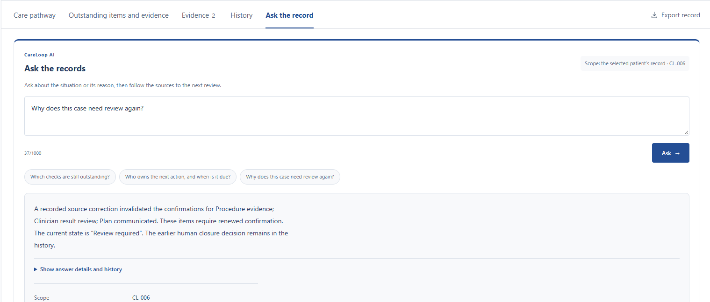

# CareLoop hands-on guide

[Home](../README.md) · [日本語](demo-guide.ja.md) · [Demo video](https://youtu.be/y_zqr-R8R3g)

Follow **CL-006 / Kenji Morgan / SYN-006**, the case used in the completed demonstration. Start by inspecting the correction, ask why review is needed, and trace the answer to the responsible team and next action. The current application is **v0.5.2 (RC9)**. Use synthetic data only.

## Open the demonstrated case

1. Open the [English workspace](https://careloop-demo-864232222461.asia-northeast1.run.app/?lang=en). Select **Care coordinator** under **Operating role**.
2. A new workspace starts with four cases. If **CL-006** is not present, click **Explore 300 patients** on the worklist. This explicitly adds the demonstration records and preserves the original four. If the workspace already has 300 records, continue directly.
3. Select **All records**, clear any restrictive filters, search for **CL-006**, then open **Kenji Morgan**.

An independent trial needs a separate browser profile or private window. Tabs in the same profile share the workspace. A session lasts 24 hours; after expiry, use **Start a new workspace** when the application offers it. **Back to overview** returns to the list without resetting the data. Dates, counts and revisions can differ after other actions. Operating roles are demonstration personas, not verified clinical identities.

## 1. Inspect the earlier closure and the correction

Open **History**. Expand the record details for the earlier **Close pathway** event, then inspect the later evidence event. The previous closure remains a historical decision.

Open **Evidence** and expand **Correction to procedure completion report** (`EV-SCALE-006-02`). It corrects `EV-SCALE-006-01`. The active source states:

> Patient SYN-006. Correction: consultation only. Required procedure not performed. Rebooking required.

The original report remains available as a superseded source. In this seeded example, the source text explicitly says the required procedure was not performed; an unconfirmed checkbox by itself would not establish that fact.

## 2. See which confirmations require review

Open **Outstanding items and evidence**. Inspect **Current status of the six required confirmations**.

| Confirmation | Starting CL-006 state |
| --- | --- |
| Patient acknowledgement | Confirmed |
| Clinical consultation | Confirmed |
| Procedure evidence | Previous confirmation invalidated |
| Clinician result review | Previous confirmation invalidated |
| Plan communicated | Previous confirmation invalidated |
| Referral accepted | Confirmed |

Three of six remain valid. **Care pathway** also shows the 3/6 checklist and the previous closure record. The case is **Review required**. The record must satisfy the current closure conditions before a clinician can close it again.

## 3. Ask Gemini about the record

Open **Ask the record** and enter:

**Why does this case need review again?**

Click **Ask**. Read the concise answer, then follow **Sources for this answer** and **Records checked at**. Open **Show answer details and history** when more detail is needed. Source links lead back to the relevant evidence or history in the case.

Try another natural-language question, such as:

- **Which checks are still outstanding?**
- **Who owns the next action, and when is it due?**

Gemini interprets the question and selects relevant supplied record blocks and original passages. The service binds the answer to recorded values, source references and the check time. Missing facts or conflicting active sources are identified. Exact wording can vary with the question; compare the stated facts and citations. Asking does not change the case or authorize an action.

If records have changed, ask again using the latest state. If the AI is unavailable or usage is limited, the application reports that condition and the evidence/history views remain available.

## 4. Identify who acts next

In **Outstanding items and evidence**, inspect **Current accountable owner**, **Awaiting acceptance** and **Next action**.

In the starting CL-006 example, **Follow-up team A** is accountable, no handoff is awaiting acceptance, and **No next action schedule has been recorded**. The system exposes that gap; a staff member decides and records the follow-up separately.

To see the handoff rule, inspect **CL-002**. A proposed receiving team becomes accountable only after accepting the handoff. A request by itself does not transfer ownership.

## 5. Inspect the patient's view

With the intended case selected, open **Patient journey**. Review the next-step guidance, care contact and received documents. To try recording a response, switch **Operating role** to **Patient** and select **I understand the next step** or **I would like more explanation**, optionally add a note, then click **Record response**.

This optional action writes a patient response and changes the case revision. Reading acknowledgement and reported understanding remain separate records. A response does not confirm that an unfinished procedure occurred. Switch back to **Care coordinator** for staff review.

## Questions about the worklist

Return with **Back to overview**. The question panel can address **All workspace records** or **Records matching this list**. Choose the scope before asking a question such as **How many follow-ups need review?** or **Are any next actions overdue?**

Counts refer to follow-up records in the stated scope and time window. Individual detail may be limited when many records match; narrow the list or open a case to inspect its sources. Do not read the displayed record count as a verified count of unique real patients.

## Optional PDF upload and closure exercise: CL-001

The two downloadable PDFs concern **CL-001 / Alex Morgan / SYN-001**, a separate scenario. Do not upload them into CL-006. This exercise shows the actions that produce a closure and then a correction; the main CL-006 walkthrough above inspects an already prepared sequence.

- Select **Clinician** under **Operating role**, then open **CL-001**. If it has already been changed, use an independent workspace for the starting state.
- Download the [later completion report](https://github.com/solidfdn/careloop/raw/refs/heads/main/demo-data/CareLoop_Demo_Completed_SYN001_v1.pdf) and [correction report](https://github.com/solidfdn/careloop/raw/refs/heads/main/demo-data/CareLoop_Demo_Correction_SYN001_v1.pdf). Keep both unchanged. [Fixture details](../demo-data/README.md) identify their historical labels and checksums.
- English and Arabic scheduling use **Abu Dhabi time (UTC+4)**; Japanese uses **Japan time (UTC+9)**. Use a future synthetic date in the displayed zone. It is not a clinical deadline.

### 1. Inspect the original source

Select **CL-001**, open **Evidence**, and expand **Specialist visit report**. Read the source statement: consultation only; colonoscopy not performed; rebooking required.

Return to **Care pathway**. Keep **Rules baseline** selected under **Check method**, then click **Check evidence**. Inspect the source quotations and closure checklist. A completed visit does not establish completion of the procedure; closure remains unavailable while requirements are unmet.

### 2. Record the next action

Click **Record next action** and enter:

| Field | Synthetic example |
| --- | --- |
| Next-action owner | Screening coordination |
| Next action | Obtain and review the later procedure report for SYN-001. |
| Scheduled time | A future demo date and time, in the displayed zone. |

Click **Save record** and check the saved owner, action and schedule.

### 3. Add the later report as new evidence

In **Evidence**, select `CareLoop_Demo_Completed_SYN001_v1.pdf` under **PDF to import**, then click **Import PDF**. Expand the extracted page and use **Open original** to compare the patient reference and full statement with the original PDF.

Give **Evidence title** a recognizable name, such as `Later procedure completion report - SYN-001`. Keep **Earlier evidence being corrected** set to **Add as new evidence**. Check the comparison declaration and click **Register confirmed evidence**. Wait until registration completes.

This later report describes a subsequent event. Preserve the earlier report, which accurately recorded that the procedure had not yet been performed.

### 4. Record the human confirmations

Return to **Care pathway**.

1. **Confirm procedure**: choose the later report under **Active evidence supporting completion**. Explain how the later report resolves the earlier incomplete findings, check the verification declaration and save.
2. **Complete next action**: record that the requested report was obtained and reviewed, with the supporting reason, then save.
3. **Review result & plan**: record the synthetic result/plan review and save.
4. **Record explanation**: record the synthetic explanation and save.

Describe the exercise as a process demonstration. The fixture contains no real clinical findings, and no real patient has been contacted. Inspect all six checklist items; the seed case supplies the other demonstration confirmations.

### 5. Check the current evidence and close

Run **Check evidence** after changes. The verified v0.4.12 rules-only walkthrough produced zero review items. If **Review items and judgments** shows zero, no item judgment is needed; the six closure confirmations still apply.

If review items are listed:

1. Compare each quotation with its linked source, then click **Review and record judgment**.
2. Under **Disposition**, choose **Resolved** if the evidence establishes resolution, **Not applicable** if the item does not apply, or **Action required** if follow-up is needed. For **Action required**, first record an owner and an open next action; adopting an item does not resolve it or permit closure.
3. Select the relevant **Active evidence reviewed**, enter the **Reason and verification**, then click **Save judgment**. Base the decision on the current source documents.

When all required confirmations are current and current review items have been handled, click **Close pathway**. Enter the synthetic closure reason, check the declaration and save. The case becomes **Closed**, and its closure decision is retained.

Gemini is optional. If you choose **Gemini + rules (not clinically validated)**, inspect the **AI execution records** and review any proposed items against the original source. Candidate count may be zero. This optional upload exercise can use the deterministic rules without a model call; natural-language questions use the configured Gemini connection.

### 6. Correct the later report

In **Evidence**, import `CareLoop_Demo_Correction_SYN001_v1.pdf`. Compare the original and extracted text. Its statement says that only the first stage was performed and required steps remain pending.

Enter a recognizable title. Under **Earlier evidence being corrected**, select the **later completion report from step 3**. Check the comparison declaration and register the confirmed evidence.

### 7. Verify the resulting state

Inspect **Care pathway**, **Evidence** and **History**. Run **Check evidence** again and confirm:

- The case requires renewed review.
- The correction explicitly refers to the later report; that report is superseded.
- Procedure evidence, clinician result review and plan communication require renewed confirmation. In the verified walkthrough, three of six confirmations remain valid.
- Closure is unavailable while the corrected incomplete state remains unresolved.
- Earlier source PDFs and the previous closure decision remain available.

Do not confirm completion against a source that says required steps remain pending.

See [validation](validation.md) for checks with their release, date and scope, and [scope and limitations](scope-and-limitations.md) for the boundaries of the prototype.
